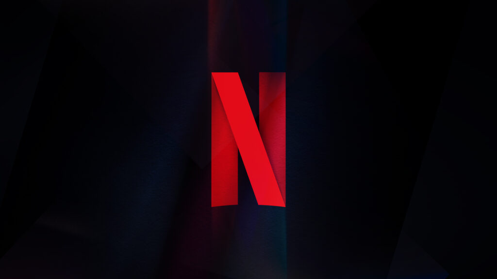

# Aula 1 - 16/09/2026

## Tópico 1: O que é Infraestrutura?

A Infraestrutura nada mais é o limitador de tecnologias(no sentido de: uma boa Infraestrutura te permite crescer, uma má não);

Infraestrutura é o conjunto de sistemas, instalações e estruturas básicas que sustentam o funcionamento de uma atividade;

É aquilo que vai sustentar sua aplicação;

- Os players cuidam da Infraestrutura(a segurança em si dos SEUS dados é sua responsabilidade);

- Modelo de Responsabilidade COmpartilhada(Isso vale para todos os Players)
    - "Tudo que eu posso encostar é responsabilidade do Player";

Available Zone -> cada Data Center giganteco dos Players

## Tópico 2: Mainframes ao Multi-Cloud

### Mainframes(1960 - 1980)

- Características principais:
    - Computação centralizada;
    - Processament batch;
    - IMB System/360;
    - Hardware de alto custo;

- Limitações / Evolução:
    - Acesso restrito;
    - Forte dependência de um ambiente central(alto acoplamento);
    - Mudanças lentas;

### Cliente-Servidor(1985-1999)

- Características principais:
    - PCs corporativos;
    - LANs/WANs, servidores departamentais;
    - ERP;
    - Email;
    - Banco de dados;

- Limitações / Evolução:
    - Sprawl de servidores;
    - Baixa utilização
    - Surgimento de silos;

Aqui democatrizou o acesso à tecnologia, porém trouxe um novo problema: cada app ou departamento passou a manter servidores físicos própios

- Cada servidor usava entre 10% e 15% de sua capacidade;

- Cada servidor exigia energia, licenças, manutenção, backup e equipe técnica;

- A falta de padronização criava stacks diferentes entre equipes, e aumentava a dificuldade de suporte;

### Virtualização(2000-2005)

- Características principais:
    - Vários sistemas no mesmo Hardware;
    - VMware;
    - Xen;
    - Hyper-V;

- Limitações / Evolução:
    - Melhor utilização;
    - Consolidação;
    - Criação de uma VM em minutos;

A virtualização permitiu exeutar várias máquinas virtuais no mesmo servidor físico. Isso fez com que aumentasse a utilização do Hardware, reduziu espaço e energia.

### Cloud(2005-2018)

- Características principais:
    - S3 e EC2;
    - Pay-as-you-go;
    - Elasticidade;
    - Serviços sob demanda;
    - Expansão global;

- Limitações / Evolução:
    - Infraestrutura deixa de depender do ciclo de compra de hardware;

A AWS abriu seus serviços de Infraestrutura em 2008, com S3 e EC2. Assim mudou a fomra de adquirir poder computacional: em vez de comprar peças antecipadamente, começou-se a alugar recursos sob demanda.

- Pay-as-you-Go: paga apenas pelo o que usa;

- Elasticidade: capacidade de aumentar seu poder computacional conforme a demanda;

- Alcance global: infraestrutura distribupida por diferentes regiões, fazendo com que as empresas não precisassem mais montar seus própios datacenters;

- Provisionamento veloz: a mudança de poder computacional por sofware;

### Multi-Cloud(2005-2018)

- Características principais:
    - Containers;
    - Kubernetes;
    - Serverless;
    - Edge;
    - IA/ML como serviço;

- Limitações / Evolução:
    - Aumenta a flexibilidade, mas também a necessidade de governança e gestão de custos;

## Tópico 3: Estudo de caso - Netflix

- Migração foi feita entre 2008 e 2026;

- A arquitetura agora é mais distribuída, assim, em caso de falha reduz o impacto no produto ao todo;

