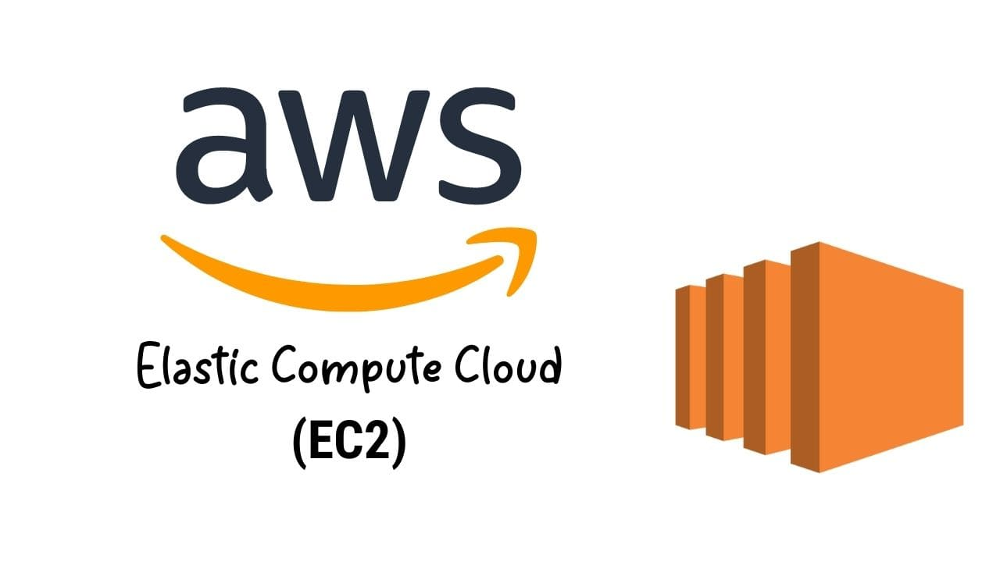

# Aula 4 - 07/10/2026

- "Comodidade tem um preço"

## Tópico: Segurança de Rede

- Ao criar uma EC2, é necessário escolher uma imagem do SO da máquina;

- Tem um mundo de máquinas para montar aqui, desde focada em processador, placa de vídeo, armazenamento etc;

- Processadores Graviton -> vantagem para economia de energia (danifica menos o ambiente: tem empresas que possuem compromissos com o meio ambiente), e por isso eles são mais baratos;

- Processadores com "a" são da AMD, os que não tem nada é Intel;

- Também é necessário selecionar a VPC desejada e a SubNet para a EC2;

- Key Pair: chave segura para acessar a EC2. Depois é necessário subir a chave na máquina;

- Também pode configurar um IP personálizavel;

- Security Groups: firewall a nível de instância;

- TAGS: adicionar tags é uma prática extremamente útil para ambientes com muitos recursos;

- Depois é só acessar a máquina pelo RDP do Windows, colocar o IP da EC2, e entrar como ADM com as credenciais baixadas;

- Quando falamos de ELASTICIDADE OPERACIONAL também estamos falando em velocidade de negócio.
    - No modelo On-Premise, até você pedir o upgrade, e até chegar na sua empresa vai em torno de 4 meses. Fora que também gasta mais dinheiro(transporte, profissional para instalção da peças etc);
        - No Cloud, para fazer o upgrade de máquina é questão de minutos. Também pode ser mais barato, pois depois que passar a alta demanda, é só fazer o downgrade. Assim não gasta com transporte, instalação, não precisa falar com fornecedor meses antes;

- É quase impossível uma empresa se manter no On-Premise;

- Auto-Scaling X Lambda: Na real não tem nenhuma vantagem entre elas, e sim uma necessiadade:
    - Por exemplo, microsserviços funciona perfeitamente com o Auto-Scaling. O Lambda cai mais para apps monolíticos;

- Escalonamento
    - Scale Up: melhora a configuração de uma instância;
    - Scale Out: adiciona mais unidades da instância(com a mesma configuração de hardware);

- Para mudar o volume do disco da instância, é possível fazer com ela ligada ainda;
    - Observação: os tipos de volumes mais velhos podem custar mais, assim forçando os clientes a atualizar o tipo do recurso. Assim, a AWS libera recursos para no futuro criar novos tipos de volumes;

- Dá para criptografar os volumes dos discos. Assim se a AWS for hackeada e hackers tiverem acesso ao seu disco, eles terão dificuldades para ver o que tem nele;

- Bucket(S3) -> armazenador de arquivos da AWS(Como se fosse o Blob da Azure);
    - Cada nome de Bucket deve ser único em toda AWS;