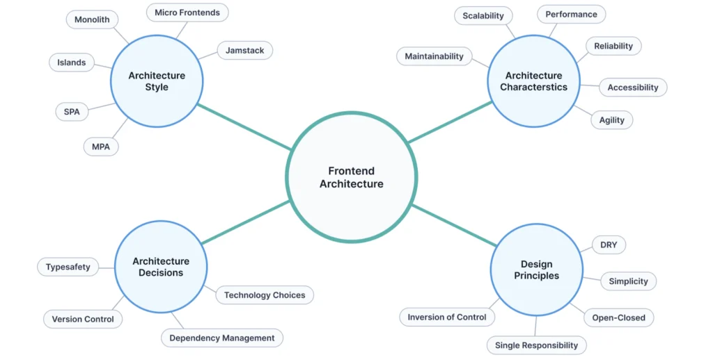
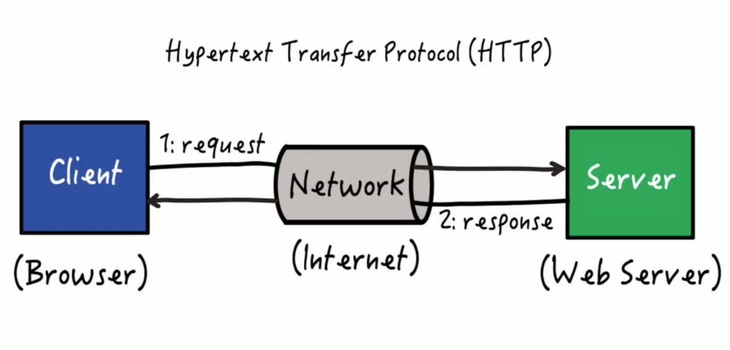
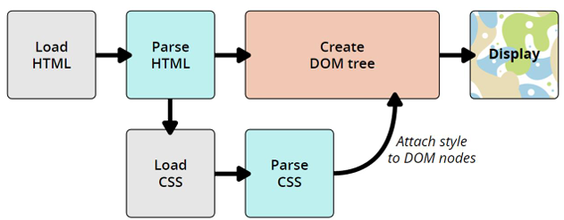
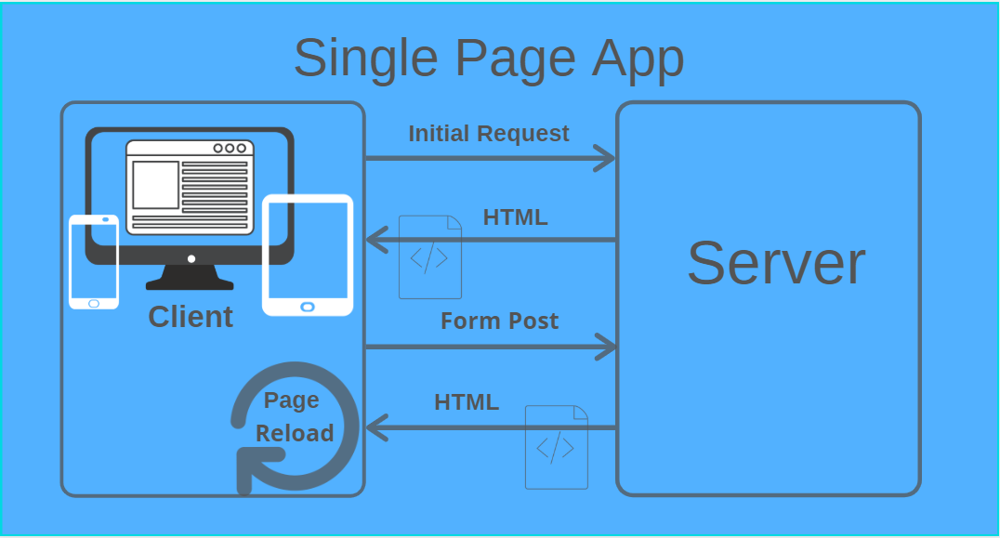

# Aula 1 - 14/09/2026

## Tópico 1: Carreira de Arquitetura

- Cultura da empresa: empresas com cultar mais horizontais tendem a ter menos divisões de cargos e funções do que empresas mais verticais;

- Número de pessoas: empresas mais exutas geralmente possuem mais profissionais generalistas e menos profissionais especialistas;

- Necessidade de projetos: projetos de longo prazo;

- T-Shaped: abordagem especialista convenviconal;

- V-Shaped: especialista em áreas adjacentes;

## Tópico 2: Arquitetura

"Arquitetura é a organização fundamental de um sistema, compreendido pelos seus componentes, o relacionamento entre eles e os princípios que direcionam seu projeto e sua evolução."

- Estilo arquitetural: define a estrutura da arquitetura(a própia arquitetura em si);

- Características arquiteturais: definição de prioridades;

- Decisões arquiteturais: o que é necessário e o que não é permitido dentro do projeto;

- Princípios de Design: boas prática ou guidelines a serem seguidas em um sistema;

## Tópico 3: Protocolo HTTP

Requisições e repostas.

- Verbos Http;

- Cabeçalhos de requisição/resposta;

### Cabeçalhos

- Autenticação;

- Proteção de páginas;

- Metadados a respeito da requisição/resposta;

### Principais verbos HTTP

- Get -> solicita dados;

- Post -> envia dados(normalmente para criar um novo recurso);

- Delete -> remove recurso;

- Put -> atualiza o recurso ao todo;

- Patch -> atualiz parte do recurso;

## Tópico 4: Engine de interpretação

- Motor responsável para interpretar códigos no browser;

- Explica comportamentos distintos para cada browser;

### Dinâmica de processamento

## Tópico 5: HTML, CSS e Javascript

### HTML

- Linguagem de marcação;

- Para páginas web;

- Interpretadas pelos navegadores;

- Utilizada para identifacar elementos em uma página;

### CSS - Cascading Style Sheet

- Linguagem de estilo de um arquivo HMTL;

- Um arquivo HTML pode estar associado a mais de um arquivo CSS;

#### Formas de utilização

- Arquivo externo:
    - Melhor modularização e manutenibilidade;
    - Separação de conceitos e responsabilidades;
    - Permite atualizar o CSS de um único lugar;

- Bloco de estilos:
    - Estilo no própio arquivo HTML;
    - Pouca reusabilidade;
    - Maior performance(por ser um único arquivo);

- Inline:
    - Css dentro das tags do HTML(algo como o <a href="https://tailwindcss.com/">TailwindCSS</a>);
    - Quase nenhuma reusabilidade;

### Javascript

- Linguagem de programação interpretada pela engine do Browser;

- Linguagem não tipada;

- Adiciona interatividade nas páginas;

## Tópico 6: Single Page Application(SPA)

- Apps de página única;

- Ao invés de recarregar toda a página, apenas recarrega o conteúdo que for necessário;

- Possui uma performance bacana;

- Definição de uma parte comum do app. Os demais conteúdos são escritos como componentes e renderizados ao entrar ná página;

- Carga maior no browser -> uma vez que a máquina do cliente é responsável por renderizar o app;

- Problemas com SEO -> como o app é renderizado dinamicamente, os mecanismos de busca não conseguem identificar o conteúdo para fazer a indexação de acordo com a busca do usuário;

- Tempo inicial de renderização maior -> a página é aberta, uma requisição ao servidor é feita para buscar os scripts, e os scripts são interpretados e só após o conteúdo é renderizado na página;

- Mapemento rotas;

