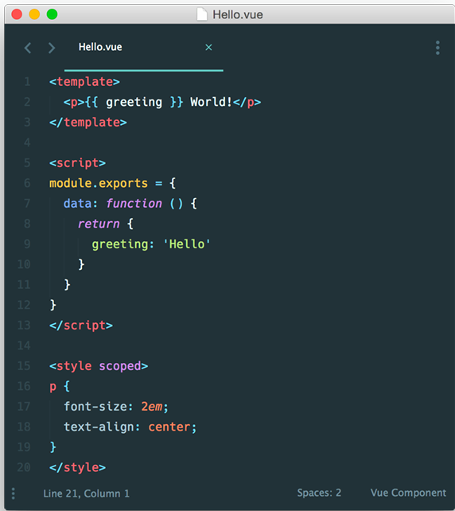

# Aula 2 - 21/09/2026

- Frameworks de código aberto podem ter uma comunidade bem ativa, o que assegura a sua utilização(dado uma vez que você possa ter problemas/dúvidas dentro do Framework, é bem provável que você vá encontrar uma solução)

- TreeShaking: verifica dentro de um projeto JS bibliotecas que não são usadas dentro do projeto, a fim de manter o código mais performático

- Fazer uma curadoria no projeto, porém não fazer tudo na mão.

- Padrão strangling: 
    - https://microservices.io/patterns/refactoring/strangler-application.html;
    - https://learn.microsoft.com/pt-br/azure/architecture/patterns/strangler-fig;

- <a href="https://jellyfish.co/">Jellyfish</a>

- <a href="https://clarity.microsoft.com/">Clarity</a>

## Tópico 1: Frameworks/Bibliotecas

"Frameworks são ferramentas que ajudam desenvolvedores a contruis aplicações, websties e sistemas deigitais. (...) frameworks podem ajudar programadores a desenvolver ttarefas mais efetivamente" <a href="https://www.indeed.com/career-advice/career-development/what-is-a-framework">What is a Framework?</a>

Framework ou Biblioteca? O Framework tendem a ser maiores e contribuem mais para o escopo a nível de aplicação. A biblioteca são mais específicas.

### Qual Framawork/Biblioteca usar?

- Depende: 
    - A stack do time
    - Se já tem alguma Code Base
    - A senioridade do time
    - Comunidade
    - Etc

### <a href="https://angular.dev/">Angular</a>

- Observação: AngularJS(1.x) != Angular(2.x)
    O AngularJS foi descontinuado, e na versão 2 foi criado o Angular em si mesmo. Era impossível apenas atualizar a versão, era necessário criar um novo projeto caso fosse atualizar para o Angular.

#### Arquitetura

- Pensado para o desenvolvimento da palicação de ponta a ponta

- Setup inicial:
    - Sistema de rotas;
    - Arquitetura e organização de pastas sugeridas;
    - Sugere o uso dos Servicees para consultas a APIs externas.

- Utiliza como base o Typescript(não é possível utilizar sem)

- Permite uma boa escabilidade. Linguagem tipada tem se tornada essencial para grandes projetos.

- Desenvolvido para permitir o desenvolvedor focar na lógica de negócio.

#### Aspectos técnicos

- Proximidade à linguagens tipadas de backend mais conhecidas(C#, Java etc);

- Utiliza conceitos de OO.

#### Comunidade e evolução

- Conferência oficial anual para apresentação de novidades (<a href="https://ai-devcraft.com/ng-conf/">NG-Conf</a>)

- Possui bibliotecas de componentes para acelerar o desenvolvimento.

#### Pontos de atenção

- Framework mais verboso

- A curva de aprendizado pode ser alta para pessoas 100% frontend
    - Necessário aprender conceitos de OO(Tipos, Heranças, interfaces etc)

- Necessário o aprendizado de conceitos do framework:
    - Componentes;
    - Diretivas;
    - Módulos;
    - Serviços;
    - Programação Reativa;
    - DI;
    - HttpClient;

#### Casos de uso comuns

- Aplicações Web corporativas;

- Aplicações de grande porte;

- Utilizada por times com mais conhecimentos em linguagens server-side tipadas (C#/Java)

### <a href="https://react.dev/">React</a>

"A JavaScript library for building user interfaces"

O Setup inicial do React vem apenas focado em COMPONENTES, porém é possível adicionar várias outras bibliotecas para suprir a necessidade do projeto.

#### Arquitetura

- Arquitetura 100% focado em componentes(tudo é um componente);
    - Componente -> Uma abstração de uma estrutura HTML;

- Utiliza o JSX;

- NASCEU focado em performance;

- Permite integração com o TypeScript;

- Permite a criação de apps SPA por meio de bibliotecas da comunidade;

- Permite a adoção incremental em projetos já existentes;

- Projetos que usam o React podem ser altamente customizáveis, pois acrescentar diversas bibliotecas.

- Possui mecanismo nativo para gerenciamento de estados(Context API);

- Não possui conceitos além de conceitos(nada de Services, Modules e outros conceitos Angular);

#### Aspectos técnicos

- Possui diversos caminhos para resoolver o mesmo problema:
    - COmponentes;
    - Hooks -> Funções que podem ser utilizadas para fazer a gestão do ciclo de vida do componente;
    - Vasta possibilidade de bibliotecas externas;

#### Comunidade e evolução

- Grande comunidade;

- Constantemente em evolução;

- Todas as evoluções, até então, são tratadas de forma para manter uma boa retrocompatibilidade;

- Eventos conhecidos: https://reactconf.com.br/;

#### Pontos de atenção

- Não tem uma estrutura de pastas e arquivos definidos;

- Mudança de mindset na criação de componentes por conta da linguagem(jsx);

#### Casos de uso comuns

- Criação de bibliotecas de componentes;

- Apps de grande porte em geral;

- Apps que possuem uma versão Mobile(<a href="https://reactnative.dev/">React Native</a>)

### <a href="https://vuejs.org/">Vue.Js</a>

"Vue is designed from the ground up to be incrementally adoptable"

Biblioteca de componentes para ser "adotada de forma incremental"

#### Arquitetura

- Focado 100% em componentes;

- Não é Framework para SPAs;

- Só é possível desenvolver SPAs com bibliotecas externas;

- Criado para possibilitar a adoção incremental de projeto já existente(principalmente legados);

- Todo o código do componente pode ser escrito no mesmo arquivo:
    - Template: a parte do HTML;
    - Script: Js;
    - Style: Css;

#### Aspectos técnicos

- Possui tipo de arquivo .vue;

- Configuração inicial utiliza o JS "puro";

- Permite usar CSS com escopo de forma nativa;

- Permite usar com Typescript;

#### Comunidade e evolução

- Comunidade menor que a React, porém bem ativa;

- Tem eventos: https://events.vuejs.org/conferences/;

#### Pontos de atenção

- Como o React, não possui uma estrutura definida;

- Deixa sempre para o desenvolvedor definir seu própio padrão;

- Como todo o código de um componente pode ficar em apenas um arquivo, então o arquivo pode crescer exponencialmente;

#### Casos de uso comuns

- Desenvolvimento de bibliotecas de componentes cross-framework;

- Componentização de apps já existentes;

- Apps de pequeno porte;

## Tópico 2: Aplicações Server-Side Rendering(SSR)

Sempre existiu, porém não para frontend

- Tem a proposta de possibilitar a criação de apps de forma componentizada, utilizando os mesmo conceitos fundamentais, mas com funcionalidade de renderização de todo (ou parte) no servidor;

- O tempo de renderização inicial é menor, uma vez que o app é processado no servidor e já é entregue ao browser.

- Em cada uma das requisições, o servidor é o responsável por devolver a página completa ao usuário, pois ela já foi pré-processada;

- Sistemas de rotas de URLs no server;

- Separação das responsabilidades pode ser mais difícil;

- Dificuldade de componentização e reaproveitamento de códigos de interface;

- Após o surgimento de FMs de criação de componentes, construir interfaces sem o uso desse tipo de ferramenta tornou-se indispensável;

- A Ux é bem parecida entre projetos SPA e SSR;

- Tem benefícios de ser mais bem ranqueada pelos SEOs;

O primeiro Framework a ter essa cada foi o Next.js, eles são altamente inspirados no React.

Pelo Angular dá para adaptar nativamente a aplicação para SSR.

## Tópico 3: <a href="https://nextjs.org/">Next.js</a>

- FM baseado em React e matindo pela Vercel;

- Implementa uma série de funcionalidades, desde o sistema de rotas até a renderização de páginas no servidor;

- É considerado um Fm Fullstack, pois:
    - Possibilita a execução de funções a nível de backend(node + serverless);
    - Consegue suportar padrões para desenvolvimento de aplicações de ponta a ponta.

### Tipos de renderização

O Next consegue trabalhar de 4 formas diferentes:

- SSR(padrão) -> todas as páginas são renderizadas no server e é devolvida para o cliente.;

- SSG(Static Site Generator): a página é renderizada em tempo de build e exportada já pronta em .html(é a forma mais rápida de renderizar);

- CSR(Client-Side Rendering)(fetch): como SPA, as requisições são processadas no cliente;

- Híbrida: parte estática, parte renderizada no clinete(as vezes até parte renderizada no server). Observação: o deploy de app híbridos é mais complexo;

## Tópico 4: Arquitetura de CSS(Início apenas)

- Css importa;

- Um Css mal feito prejudica toda a manutenção de um app web;

- Refatorar Css não é nada fácil;

