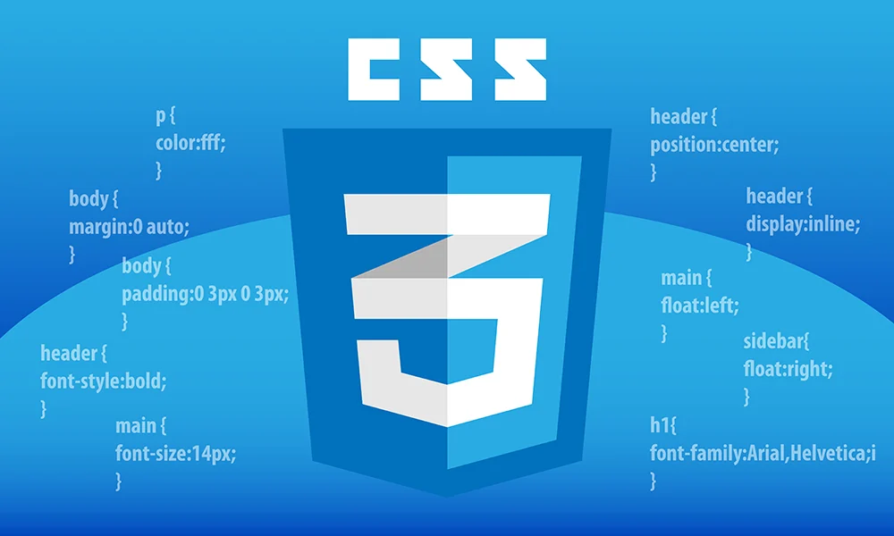
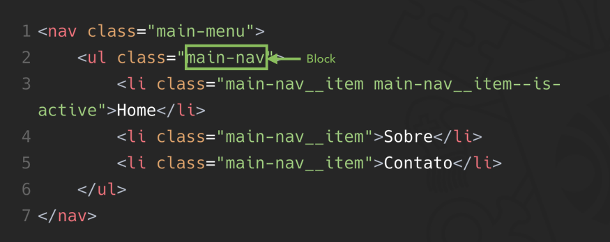
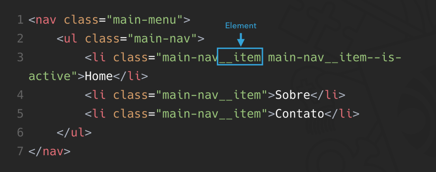
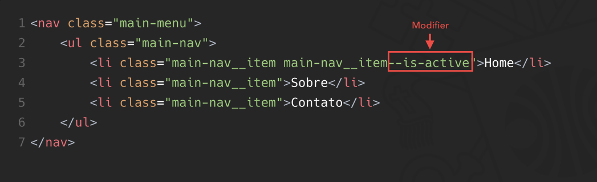
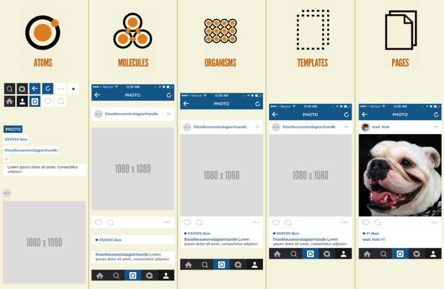
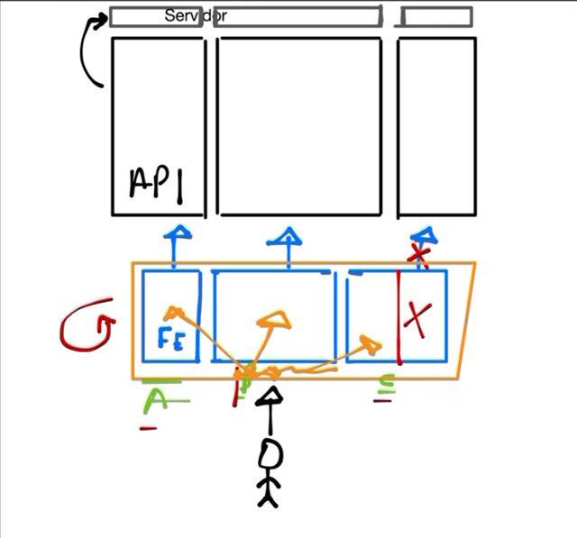
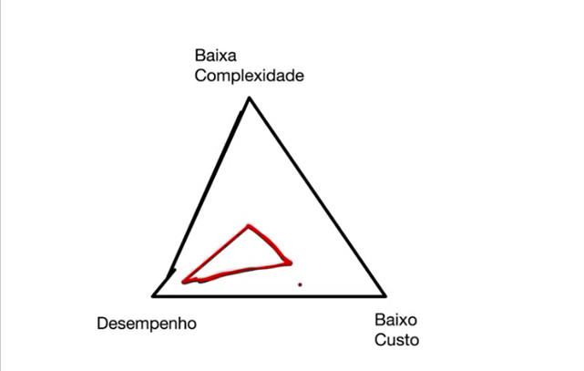
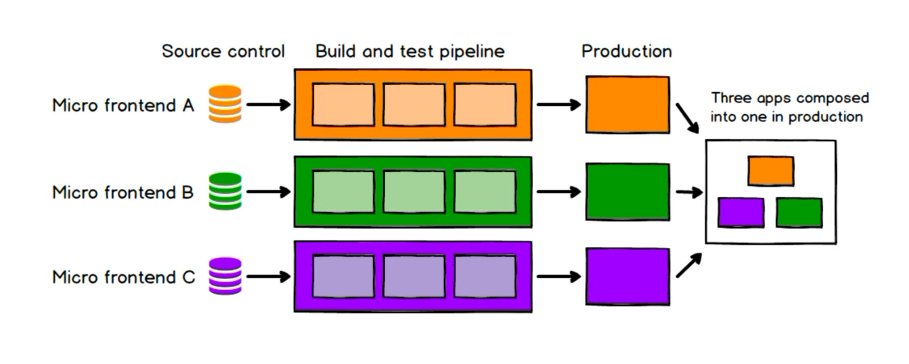

# Aula 3 - 28/09/2026

- É necessário pensar na estruturação de CSS, pois a longe prazo pode virar uma bagunça com o decorrer do tempo;

- Não é nada fácil de refatorar, pois por exemplo, não existe testes para CSS. Também tem a chance da estilização do CSS ser sobrescrito;

- O macete é: já de início definir um padrão de escrita de CSS, para que diminua as chances de refatoração posteriormente.

- "O Frontend quase nunca é o gargalo de execução, o mais comum é gargalo de infraestrutura"

## Tópico 1: Arquitetura de CSS

- CSS importa, e muito;

- Um CSS mal feito prejudica toda a manutenção do projeto web;

- Refatorar CSS não é nada fácil;

- Alguns guias para mitigar possíveis problemas:
    - BEM: Block Element Modifier. Convenção para nomear classes. Visão clara de estados, porém o nome das classes fica muito grandes;
        - Block -> header, container, menu, checkbox, input;
        

        - Element -> ítem de menu, ítem de lista, título de cabeçalho;
        

        - Modifier(estado em que o elemento se encontra) -> disabled, active, fixed, background cinza;
        

        - Primeiro o block, depois o element, e por último o modifier, formato a ser seguido: .block__element--modifier;

    - OOCSS: Object Oriented CSS(APenas conceito, nada a ver com OO mesmo de Java por exemplo). Foco mais nas propiedades do que na nomeclatura em si;
        - Separação entre CSS de estrutura e skin;
        - Structure Properties(Imutáveis): Width/Height/Paddng/Margins/Overflow;
        - Skin: COlor/Backgorund/Font/Shadow; 
    - Bootstrap uso esse padrão;
    - É uma boa para reaproveitar códigos de estilização;

    - CSS funcional: <a href="https://tachyons.io/">Tachyons</a> e <a href="https://tailwindcss.com/">Tailwind</a>;
        - Ideia para ter micro classes de CSS para compor um elemento;
        - Cada classe altera uma única prop de CSS;
        - Classes smepre tratam responsividade desde a concepção;
        - É uma boa ideia, mas deixa o arquivo HTML fica verboso;
    - CSS Modules;
        - Forma de escrever estilos que tem um escopo mais fechados a um grupo de elementos HTML(Mais utilizado ao desenvolver app de componentes);
        - Resolve problemas em que o seletor de CSS precisa estar associado a um único componente sem correr risco de alterar estilos globais;
    - <a href="https://atomicdesign.bradfrost.com/chapter-2/">Atomic Design</a>: Parte de Átomos, para moléculas, organismos, templates, páginas;
    

- CSS está ligado diretamente a PERFORMANCE:
    - Override de estilos é custoso para o navegador(existe recalculo de estilos! E tem certo custo ao longo do prazo);
    - Evitar uso de !important;

## Tópico 2: Ferramentas de Build

Quase tudo de engranagem que faz a etilização funcionar passar por uma ferramenta de build.

Ela nos auxilia fazer automação de tarefas que não percebemos. Por exemplo, ao desenvolver um app utilizando algum Framework, é necessário converter para HTML, CSS e JS para o browser ler.

Ele também otimiza a aplicação, pois ele remove códigos não utilizados.

Quebra de arquivos de build muito grandes.

O nome também de funções e variáveis são alterados para otimizar o desempenho.

Inserção automática de js/css como referencia no HTML sob demanda.

### <a href="https://vite.dev/">Vite</a>

Proposta de ter um ambiente de desenvolvimento mais eficiente e rápido, de acordo com que as alterações locais vão sendo feitas

## Tópico 3: Arquitetura de MicroFrontends

- Separar o código(tanto back quanto front) em algumas partes, dá algumas vantagens:
    - Cada time(a, b, c) tem sua própia entrega independente;
    - Entrega mais rápida também devido ao escopo menor do código(tanto para escrever, quanto para testes, para build);
    - Se lançar uma coisa defeituosa para produção, causa menos impacto por cada time já ter sua própia entrega, então uma entrega defeituosa não prejudicarará o resto;
    - Também dá para diversificar a stack do front, um time trabalha com react, o outro com Angular etc;

- Possibilidade de migração gradativa do código legado;

- Pipeline de build, teste e deploys mais rápida e idependente;

- Porém, ao adotar essa estratégia, aumenta a complexidade de manutenção;

Triangulo dessa proposta:

Um projeto com MicroFrontends necessita ter uma aplicação Orquestradora(pois o usuário final não sabe qual microFrontend ele vai ter que acessar).
A aplicação Orquestradora(aplicação de entrada) vai ser onde irá tomar decisões, como por exemplo renderizar quais componentes necessários.

É possível adotar o Microfrontends desde apenas por páginas até por seção de cada página. Quanto mais divido o frontend ficar maior a sua "granularidade".

### Formas de implementação(da mais simples para a mais complexa)

#### Implementação em tempo de build

- Módulos/aplicações são publicados como pacotes no NPM;

- O projeto base é responsável por agrupar todas as dependências no package,json e fazer a gestão da release;

- A cada nova versão dos micro-fronts, um build na aplicação base deverá acontecer para subir a versão do package.json;

#### Module Federation

- Integração por meio de federação de módulos do webpack;

- Assim como um módulo interno pode ser importado no js com a sintaxe import;

- Dessa forma, um micro frontend pode estar hospedado em uma determinada URL e ser importado por outra aplicação;

- Não depende de nenhum FM ou biblioteca, dá para fazer com mais de uma stack;

#### Single-SPA

- O single-spa é uma lib para construção de micro frontends baseados na arquitetura SPA;

- Foi construída para suportar um app com multiplos FMs;

#### Integração através de web components

Os WebComponentes são componentes customizados que dá para rodar em qualquer app. É possível por exemplo pegar um elemento feito em React(junto com um Adaptador de React no caso) e transformar em um WebComponent.

- Ideal para fazer migração de software ligado;