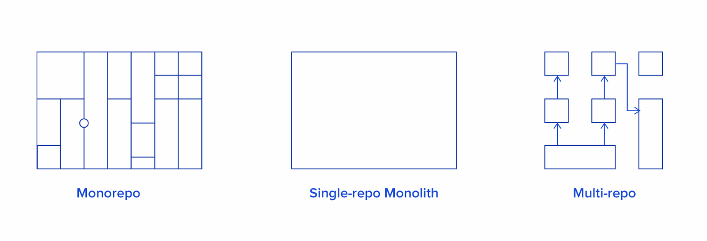
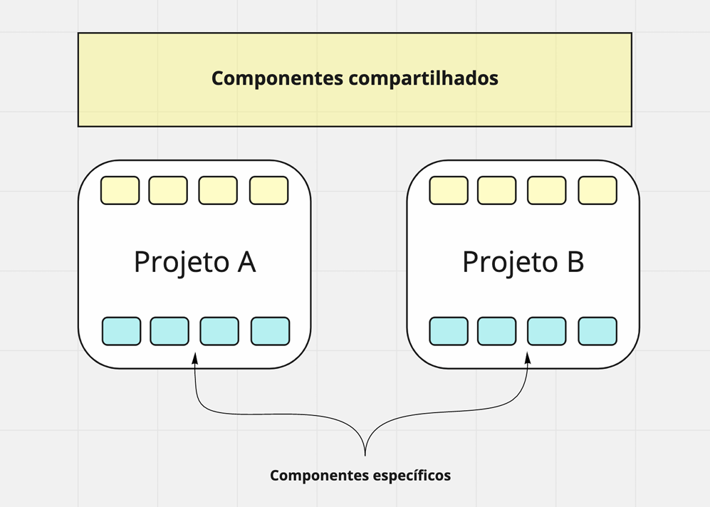

aa# Aula 4 - 05/10/2026

## Tópico 1: Arquitetura de aplicações em Monorepos

Um único repositório para diversos projetos/dependências(não confudir com Monolítico)

- Isolamento dos pacotes através de workspaces, com possibilidade de dependencia entre eles;

- Novas alterações não requerem o build e teste de toda a codebase;

- Controle de versão tanto no repositório quanto nos pacotes;

- Refatoração fácil de configurações globais e compartilhadas entre os pacotes;

- Observação: Um SLN com mais de um projeto de .NET já é na teoria um Monorepo;

### Por que usar Monorepos?

- Simplifica o uso de código compartilhado;

- Simplifica o processo de desenvolvimento: se voce faz uma alteração em um componente de compartilhado, você pode alterar tanto o componte quanto as demais parte onde ele é utilizado, tudo isso em apenas um commit;

- Facilidade em configurar versões uniformes para bibliotecas de terceiros em todos os pactoes de um mesmo repo;

### Outras alternativas

- Monorepos -> - ;
    - Um perigo é que se for necessitado uma refatoração brutal nesse tipo de projeto, é necessário ter uma boa rastreabilidade de dependencias entre apps/pacotes, pois se não uma única mudança pode resultar na refatoração do projeto inteiro;
    - Pode transformar o projeto orientado à "Spaghetti"(puxa o macarrão e só Deus sabe daonde vem);

- Monolito -> nem sempre é a pior escolha, pois para projetos mais simples cairia bem;

### Ferramentas para Monorepo

#### <a href="https://nx.dev/">Nx.dev</a>

Uma lib para auxiliar na gestão de Monorepos;

- Existe conceitos muito interessantes nesse tipo de repositório;
    - Executa um comando para pegar todas as alterações de pacotes de uma só vez. Ou inicializa tudo de uma vez;
    - Também ele deixa salvo na nuvem builds, assim, quando não houver alteração na parte daquele build, ele já puxa o que está na salvo. Esse processo deixa o projeto mais otimizado(Cache remoto);
    - Mostra um grafo de dependências entre projetos/pacotes;

#### <a href="https://turborepo.dev/">TurboRepo</a>

Funcionalidade parecidas com o Nx.dev

## Tópico 2: Design System(da parte visual)

Traz uma visão de como gerenciar a estilização do projeto.

Nada mais é que uma lib de componentes visuais com intuito para padronizar a interface da aplicação. Um exemplo disso é o <a href="https://getbootstrap.com/">Bootstrap</a>.

- Documentação contendo todos os compoenentes de um projeto e suas props;

- Formato prático para manter a consistência visual entre múltiplos projetos de forma a garantir sempre o mesmo comportamento para o mesmo componente siversas vezes;

- Componentes interoperáveis entre todos os projetos;

- O Design system fica separado de regra de negócio;

- Foi daqui que saiu o conceito de Grids;

- Não precisa ficar criando Design System sempre, porém para projetos grandes é importante criar um;

- Muitas vezes, ao construir o Design System, o projeto já estará em andamento, pois tempo é dinheiro;

### Papéis dentro do Design System

- UI Designer: projeta as interações e as guide lines visuais de acordo com a proposta;

- Arquiteto: projeto o processo de desenvolvimento, adoção, guidline de códgio, ferramentas, arquitetura de projeto e o build/deploy;

- UI Developer: desenvolve componetes e aplica os estilos definidos pelo profissional de desing;

### Design System - Casos

#### Documento de especificação

- Documentação com apenas as diretrizes de design;

- Não possui implementação;

- Normalmente utilizado para direcionar a criação de aplicações visuais internas;

- Pode ser implementada por qualquer FM ou metodologia;

- O <a href="https://m3.material.io/">Material Design</a> e o <a href="https://blog.duolingo.com/hub/design/">Duolingo</a> são exemplos disso;

#### Implementação de estilos

- Contém a implementação de classes CSS para serem utilizadas;

- Contém sugestões de estruturas HTML para serem utilizadas em um conjunto com as classes de CSS desenvolvidas;

- Pode conter js a fim de adicionar mais interações com o usuário final;

- Conceito de Tokens: faz a gestão de todas as variáveis do Design System(cores, espaçamentos etc);

#### Implementação baseada em FrameWork

Como o <a href="https://material.angular.dev/">Angular Material</a> ou <a href="https://mui.com/">MUI</a>.

Agiliza muito o Desenvolvimento do produto.

- Implementa todos os estilos e estruturas HTML em componentes utilizando alguma biblioteca/FM;

- Possui todas as interações com o usuário já implementadas;

- Possui alto acoplamento com o FM na qual foi desenvolvido;

- Acho que o Blazor pode ser um exemplo disso;

##### Problema dessa abordagem

Para sempre vai ficar amarrado nesse ambiente, não vai dar para reaproveitar o Design System ou Tokens. Se surgir outro projeto de outra stack, será necessário começar do zero.

#### Implementação generalista

"While building a Design System in Angular, React or Vue is quite a bit better than the too-open-ended approach used in Bootstrap, it has one major flaw: it only works if the rest of your company has standardized on that single framework!"

O <a href="https://ionicframework.com/">Ionic</a> é um caso de implementação generalista. O Ionic cria uma abstração em JS que gera um código nativo para Android e IOS. 

- Implementa estilos, estruturas HTML e comportamentoos em bibliotecas genéricas;

- Baixo acoplamento com a biblioteca em que foi desenvolvida;

- Poucas referências por ser uma necessidade recente;

- Complexidade de implementação;

##### Ferramentas e implementações

- <a href="https://www.npmjs.com/">NPM</a>: gerenciador de pacotes do NODE compatível com projetos WEB;

- <a href="https://stenciljs.com/docs/introduction">Stencil.js</a>: lib de componentes que faz o build para diversas stacks ou webcomponents;

- <a href="https://svelte.dev/">Svelte</a>: lib de componentes que faz o build para js puro - o própio svelt trabalha apenas em tempo de desenvolvimento;

